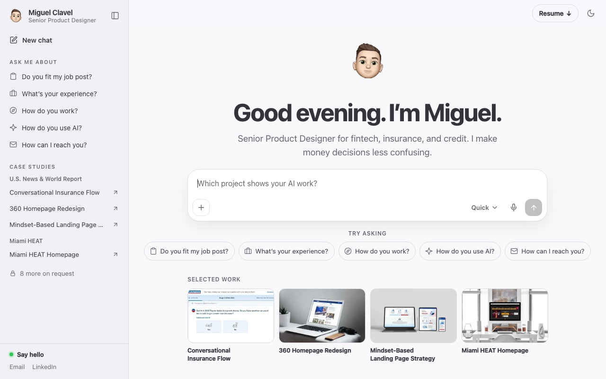
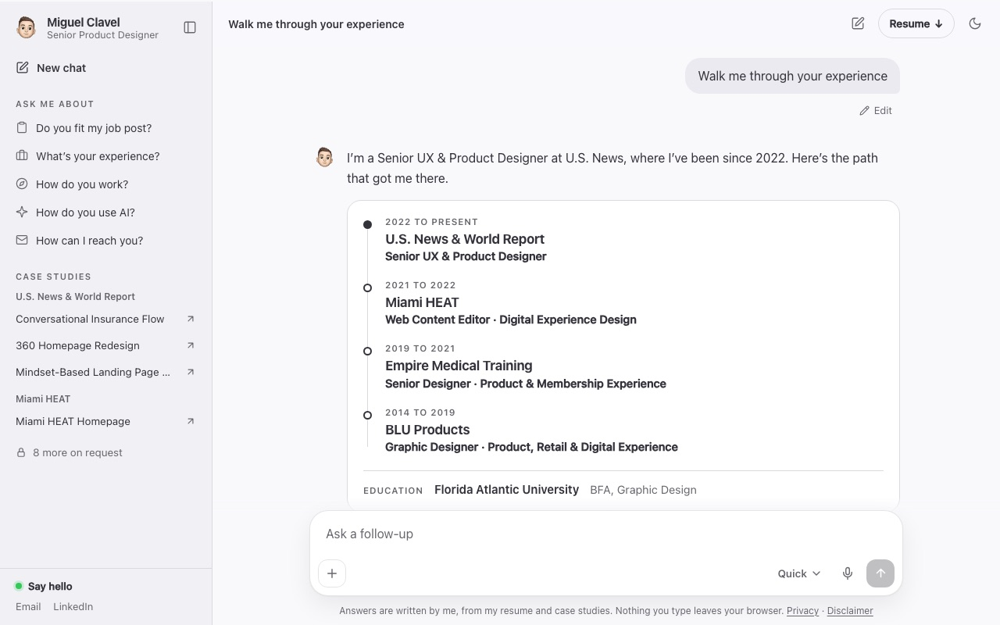
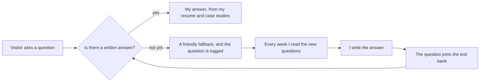

# A portfolio you can talk to

**[chat.miguelclavel.com](https://chat.miguelclavel.com/?utm_source=github&utm_medium=chat-portfolio)** · Designed in Claude Design, built with Claude Code.

<picture>
  <source media="(prefers-color-scheme: dark)" srcset="assets/home-dark.jpg">
  
</picture>

AI is changing the way people look for things. We don't want to dig through pages anymore, we just ask a question and expect an answer right away. So why should a portfolio be any different?

This one is inspired by Claude's interface. Instead of scrolling through projects, visitors ask about my background, resume, projects and experience. **Every answer is written by me, from my own resume and case studies, so it never makes things up about me.**

## What it does

- **Ask, type or talk.** Questions about my work, my process, how I use AI, or how to reach me. Typos, text speak, a few common questions in Spanish, and questions about "Miguel" in the third person all reach the right answer.
- **Paste a job description.** It goes through my projects and experience to find the most relevant work for that role, so it's easier to see how the work connects without digging through everything.
- **Quick or detailed.** A straight to the point answer, or a longer one with the design decisions and process.
- **Try asking.** Suggested questions under the box, written as questions so they read as something to tap.
- **Light and dark mode**, keyboard navigable menus, and a layout that works on a phone.

## How it gets better every week

When someone asks something it can't answer yet, the question gets recorded. Every week I review those questions and write new answers. **Every real question becomes a test**: the bank has more than 2,000 questions, and every change to the site has to pass it before it can go live.

A real example: someone typed "Tell me about Miguel’s work" and got the fallback. The fix taught the chat that people talk about me in the third person, and that question is now one of the tests.

**[Read the build log](BUILD-LOG.md)**: from idea to live, the key decisions, and the first real feedback, fixed the same day.

## Privacy

The log is small on purpose. No IP addresses, contact details are removed from questions, and nothing a visitor types is saved unless they send it. There's a [privacy page](https://chat.miguelclavel.com/privacy?utm_source=github&utm_medium=chat-portfolio) that says exactly what is kept.

## How it's made

- Designed in **Claude Design** and built with **Claude Code**
- Runs on **Cloudflare Workers**, with a small database for the question log
- A build step that checks every answer and every page before deploying
- Search and AI friendly: page titles and descriptions for Google, structured data, and an `llms.txt` so AI assistants can read a plain summary

The source stays private. The pieces worth copying are open: [interaction-recipes](https://github.com/miguelclavel/interaction-recipes), [pixel-run-game](https://github.com/miguelclavel/pixel-run-game), [name-hover](https://github.com/miguelclavel/name-hover), [pixel-trail](https://github.com/miguelclavel/pixel-trail) and [wave-line](https://github.com/miguelclavel/wave-line).

---

By [Miguel Clavel](https://github.com/miguelclavel), Senior Product Designer. The full portfolio is at [miguelclavel.com](https://miguelclavel.com/?utm_source=github&utm_medium=chat-portfolio).
